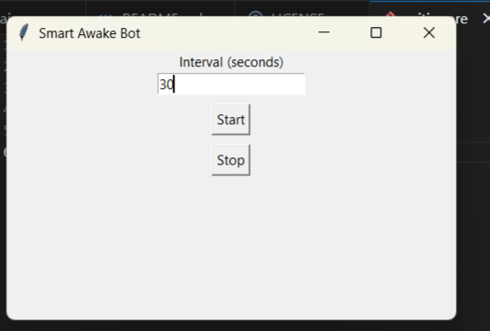

**Project Title**
Smart Awake Bot

**Screenshots**

**Features**
* Prevents system inactivity
* Random mouse simulation
* Keyboard simulation
* Custom interval
* Desktop GUI

**Technologies**
* Python
* Tkinter
* PyAutoGUI
* PyInstaller

**Installation**
* Git clone https://github.com/kruti20/smart_awake_bot.git
* cd smart_awake_bot
* python -m venv smart_bot
* pip install -r requirements.txt
* python main.py

